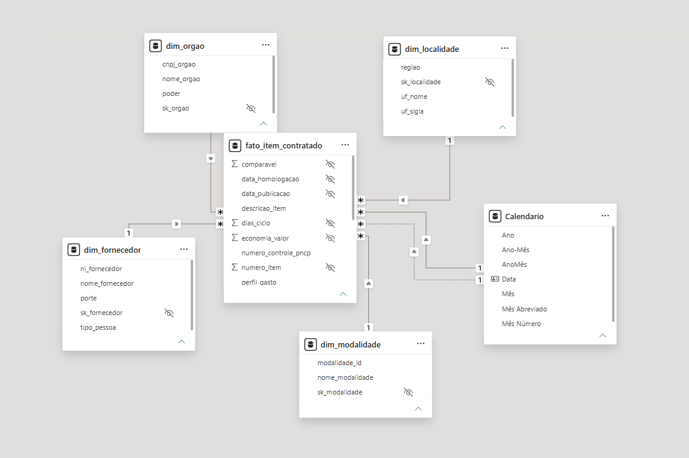
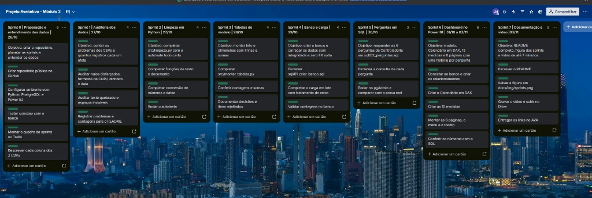

# Radar de Compras Públicas

**Análise de Dados com Python e PostgreSQL com dashboard no Power BI**
Projeto Avaliativo do Módulo 2, Semana 13 (Situação de Aprendizagem: Análise de Dados com Python – PostgreSQL [T1]).
Autor: Lucas Magalhães.

> **Vídeo de apresentação (Review de Sprint):** [assistir no Google Drive](aqui vou colocar o link do vídeo)

---

## 1. Contexto do problema

Uma consultoria de inteligência governamental, que atende órgãos de controle e transparência pública, foi contratada para apoiar a Controladoria. A Controladoria identificou gargalos nas compras e contratações públicas federais: indícios de sobrepreço em itens homologados, concentração atípica de contratos em certos fornecedores, demora entre a publicação do edital e o fechamento do certame e baixa adesão competitiva em algumas modalidades.

Os sistemas de origem não têm travas de validação, e o resultado é uma base bruta cheia de anomalias: CNPJ com máscara e sem zeros à esquerda, valores em texto livre com "R$", seis formatos de data, nulos disfarçados, acentos quebrados e datas de homologação anteriores à publicação. A liderança precisa de números confiáveis e auditáveis.

**Missão:** construir uma esteira analítica ponta a ponta que transforme essa base em um ambiente confiável, auditável e executivo.

- **Fonte:** Portal Nacional de Contratações Públicas (PNCP), dados abertos do governo federal, contratações publicadas em 2025 (amostra ao longo do ano).
- **Arquivos brutos** (`data/raw/`): `compras.csv` (2.042 linhas, uma por contratação), `itens.csv` (7.077 linhas, uma por item licitado) e `resultados.csv` (15.896 linhas, um fornecedor classificado por item).

## 2. O que o projeto entrega

| Camada | Entrega |
|---|---|
| Python (pandas) | Auditoria dos dados, limpeza com 5 desafios tratados e montagem da fato e das dimensões, conferidas com a prova real do enunciado |
| PostgreSQL | Star Schema (1 fato e 4 dimensões) com chaves, restrições e carga automatizada em lote, em transação única, com rollback |
| SQL | As 6 perguntas de negócio da Controladoria em `sql/02_perguntas.sql` |
| Power BI | Dashboard com 6 páginas (uma história por pergunta), Calendário em DAX, mais de 20 medidas, menu retrátil com indicadores e dicas de ferramenta personalizadas |

**Números-chave:** 6.126 itens na fato, 1.962 contratações, 2.652 fornecedores, 363 unidades compradoras, R$ 8,04 bilhões homologados e **R$ 992,86 milhões (14,46%) de economia** sobre os itens comparáveis.

## 3. Arquitetura

```
PNCP (CSV brutos) → Python (auditoria + limpeza) → PostgreSQL (Star Schema) → Power BI (dashboard executivo)
   data/raw/            src/                          sql/ + src/carregar.py        powerbi/
```

### Modelo dimensional



| Tabela | Papel | Linhas |
|---|---|---|
| `fato_item_contratado` | Fato: o que foi comprado (um item de contratação, com o fornecedor vencedor) | 6.126 |
| `dim_orgao` | Dimensão: quem comprou (um CNPJ de unidade compradora) | 363 |
| `dim_fornecedor` | Dimensão: quem vendeu (um CNPJ/CPF) | 2.652 |
| `dim_modalidade` | Dimensão: como comprou | 7 |
| `dim_localidade` | Dimensão: onde (uma UF, com a região) | 27 |
| `Calendario` | Dimensão de tempo, criada em DAX no Power BI | 2025 e 2026 |

Cada dimensão tem ainda uma linha de exceção `sk = -1` ("Não informado"), que não entra nas contagens acima.

## 4. Estrutura do repositório

```
├── data/raw/          CSVs brutos do PNCP (entrada do pipeline)
├── src/               Código Python (limpeza, montagem, carga e auditoria)
│   ├── config.py, banco.py        configuração e acesso ao PostgreSQL
│   ├── auditoria.py               conta os problemas dos dados brutos
│   ├── limpeza.py                 funções de limpeza (com autoteste)
│   ├── montar_tabelas.py          regras de negócio, fato e dimensões
│   └── carregar.py                carga no PostgreSQL com validação e rollback
├── sql/               01_criar_banco.sql e 02_perguntas.sql
├── powerbi/           dashboard_pncp.pbix
├── docs/              dicionário das colunas, medidas DAX e imagens
├── reports/           relatório da auditoria dos dados
├── requirements.txt   dependências Python
└── .env.example       modelo das variáveis de conexão com o banco
```

## 5. Decisões técnicas e por quê

1. **Tudo é lido como texto.** Os CSVs são lidos com `dtype=str` e convertidos por funções próprias. Assim o CNPJ não perde o zero à esquerda e nenhuma conversão automática erra valores.
2. **Auditar antes de limpar.** O `src/auditoria.py` conta cada problema (quantos registros afeta) sem alterar nada. As contagens decidem o tratamento e documentam o antes e o depois.
3. **Grão da fato = item de contratação.** Os totais da contratação (`compras.csv`) não servem, porque misturam itens. Os valores totais são recalculados: valor unitário × quantidade homologada.
4. **Um vencedor por item.** Os resultados cancelados são descartados **antes** de escolher o primeiro colocado (ordem vazia vale 1). Em empate, vale o menor `sequencial_resultado`, lido como número (2 vem antes de 10). Foram 405 itens com empate, e 62 resultados cancelados.
5. **Economia só onde dá para comparar.** Item comparável = não é Credenciamento e a razão homologado/estimado está entre 0,1 e 10. O percentual é soma da economia ÷ soma do estimado comparável, nunca média de percentuais. Em Credenciamento a economia fica vazia (esperado).
6. **Star Schema com chaves substitutas.** A fato aponta para as dimensões por chave substituta (`sk_`), e as chaves naturais (CNPJ, documento, id, sigla) ficam nas dimensões como únicas. Dinheiro em `DECIMAL` (nunca `FLOAT`) e datas em `DATE`.
7. **O banco como segunda barreira.** Restrições `CHECK` recusam quantidade menor ou igual a zero, valor negativo, ciclo negativo e homologação anterior à publicação, mesmo que o Python deixe passar.
8. **Linha de exceção em cada dimensão.** `sk = -1` ("Não informado"), fora da sequência das chaves automáticas, para uma chave estrangeira sem destino ter onde apontar. Na base atual nenhuma linha da fato usa essa exceção.
9. **Carga tudo-ou-nada.** Dimensões e fato entram em uma única transação. Antes de tocar no banco o `carregar.py` valida os arquivos (chaves únicas, sem vazios, sem chave estrangeira solta). Antes do commit ele confere contagens, chaves soltas e somas em R$. Qualquer erro dispara rollback e termina com mensagem clara.

## 6. Dicionário das inconsistências tratadas

Gerado por `python -m src.auditoria`. O relatório completo, com os detalhes de cada coluna, está em [`reports/auditoria.md`](reports/auditoria.md), e o dicionário das colunas em [`docs/dicionario_colunas.md`](docs/dicionario_colunas.md). "Linhas" são linhas do arquivo e "células" são valores individuais.

| # | Inconsistência | Onde | Ocorrências | Como será tratada |
|---|---|---|---|---|
| 1 | Máscara no CNPJ do órgão | compras.cnpj_orgao | 176 linhas | limpar_documento: manter só os dígitos (desafio 1) |
| 2 | Zero à esquerda perdido no CNPJ do órgão | compras.cnpj_orgao | 77 linhas | limpar_documento: completar com zeros até 14 dígitos (desafio 1) |
| 3 | Máscara no CPF/CNPJ do fornecedor | resultados.ni_fornecedor | 1.631 linhas | limpar_documento: manter só os dígitos (desafio 1) |
| 4 | Zero à esquerda perdido no CPF/CNPJ do fornecedor | resultados.ni_fornecedor | 353 linhas | limpar_documento: zeros até 14 (PJ) ou 11 (PF) dígitos (desafio 1) |
| 5 | Valores com "R$" | colunas de dinheiro e quantidade | 12.055 células | converter_numero: tirar o R$ antes de converter (desafio 2) |
| 6 | Espaço sem quebra ou invisível dentro de números | colunas de dinheiro e quantidade | 3.051 células | converter_numero: ignorar qualquer espaço (desafio 2) |
| 7 | Números negativos (sinal ou parênteses) | colunas de dinheiro e quantidade | 0 células | converter_numero: aplicar o sinal depois de converter (desafio 2) |
| 8 | Vírgula como decimal (formato brasileiro) | colunas de dinheiro e quantidade | 15.175 células | converter_numero: ponto de milhar sai, vírgula vira ponto (regra 12) |
| 9 | Vírgula como milhar (formato americano) | colunas de dinheiro e quantidade | 1.468 células | converter_numero: vírgula de milhar sai (regra 12) |
| 10 | Ponto ou vírgula sozinho com 3 casas (parece milhar, mas é decimal) | colunas de dinheiro e quantidade | 137 células | converter_numero: separador sozinho é sempre decimal (regra 12) |
| 11 | Datas escritas em vários formatos | 5 colunas de data | 10.549 células fora do AAAA-MM-DD simples (hora ou outro formato) | converter_data: testa cada formato da lista FORMATOS_DATA (desafio 3) |
| 12 | Datas com ano impossível (2034 a 9999), que não viram data válida | data_encerramento_proposta | 65 células | converter_data: devolve vazio (None) quando o ano está fora de 2000–2030 (coluna fora do modelo) |
| 13 | Homologação anterior à publicação (impossível) | resultados.data_resultado × compras.data_publicacao | 234 linhas de resultado | montar_tabelas, regra 7: anular data de homologação e ciclo; o item continua na fato |
| 14 | Nulos disfarçados (N/A, NULL, -, SEM INFORMAÇÃO, NÃO SE APLICA...) | todas as colunas | 15.016 células | eh_nulo / limpar_texto: viram vazio (None) (desafio 4) |
| 15 | "0" usado como nulo em campo de texto | colunas de texto | 101 células | limpar_texto(zero_eh_nulo=True); em quantidade e valores o 0 continua sendo número (desafio 4) |
| 16 | Acento quebrado (Aquisição) | colunas de texto | 202 células | consertar_acento: refaz a leitura Latin-1 → UTF-8 (desafio 5) |
| 17 | Espaço sem quebra ou caractere invisível | colunas de texto e de documento | 1.963 células | remover_invisiveis + tirar_espacos (desafio 5) |
| 18 | Espaços nas pontas ou repetidos | colunas de texto e de documento | 3.774 células | tirar_espacos: uma palavra por vez, um espaço entre elas (desafio 5) |
| 19 | Mesmo CNPJ de órgão com o nome escrito de jeitos diferentes | compras.razao_social_orgao | 67 CNPJs com mais de uma grafia → 0 depois de padronizar | padronizar_nome: maiúsculas, acento e espaços; o ranking agrupa pelo nome padronizado (regra 10) |
| 20 | Mesmo fornecedor com portes diferentes ou porte em branco em algumas linhas | resultados.porte | 61 documentos com conflito; 194 com porte a completar | montar_tabelas: uma linha por documento, com o porte mais frequente entre os preenchidos |
| 21 | Mesmo fornecedor com nomes diferentes depois de padronizar | resultados.nome_fornecedor | 16 documentos | montar_tabelas: uma linha por documento, com o nome mais frequente |
| 22 | Resultados cancelados no meio dos classificados | resultados.data_cancelamento | 62 linhas | montar_tabelas, regra 2: descartar os cancelados ANTES de escolher o 1º colocado |
| 23 | Itens sem resultado homologado | itens × resultados | 852 itens | montar_tabelas, regra 3: ficam fora da fato (não contam como rejeitados) |
| 24 | Empate na melhor posição (Credenciamento e outros) | resultados.ordem_classificacao_srp | 405 itens | montar_tabelas, regra 2: vale o menor sequencial_resultado, lido como número |

### Itens rejeitados (não entram na fato)

Dos 6.225 itens com resultado válido, **99 foram rejeitados** por dados impossíveis (7.077 − 852 sem resultado = 6.225; 6.225 − 99 = 6.126 na fato). Quando o item cai em vários casos, conta o primeiro motivo, na ordem da regra 4:

| Motivo | Itens |
|---|---|
| Valor total estimado menor que R$ 1 | 59 |
| Valor unitário estimado ausente ou menor/igual a zero | 23 |
| Valor total homologado acima de 1.000 vezes o estimado | 7 |
| Valor unitário homologado ausente ou menor/igual a zero | 6 |
| Valor total acima de R$ 1 trilhão | 3 |
| Quantidade vazia ou menor/igual a zero | 1 |
| Orçamento sigiloso | 0 |
| **Total** | **99** |

## 7. Conferência com a prova real (anexo 8 do enunciado)

O pipeline chega aos números do anexo sem copiá-los: 6.126 itens na fato, 99 rejeitados, 1.962 contratações, 2.652 fornecedores, 363 órgãos, R$ 8.044.498.805,74 de volume homologado, 5.457 itens comparáveis, economia de 14,46%, ciclo médio de 48,1 dias (máximo de 611), 230 itens sem ciclo e perfil do gasto de 60,8% (obras e engenharia), 36,6% (serviços) e 2,6% (bens). O `src/carregar.py` repete essa conferência contra o banco e o bloco final de `sql/02_perguntas.sql` confere 15 indicadores.

## 8. As 6 perguntas da Controladoria

Cada resposta está em `sql/02_perguntas.sql` e nas medidas do dashboard, com os mesmos números.

| # | Pergunta | Resposta |
|---|---|---|
| 1 | Quanto o governo economizou? | R$ 992,86 milhões, ou **14,46%**, sobre R$ 6,87 bilhões de itens comparáveis (5.457 itens, 89,08% da base). Há 27 itens com sobrepreço |
| 2 | Quem concentra o orçamento? É um risco? | Os 10 maiores fornecedores concentram **41,43%** do volume. O maior, NOW SEGUROS SA, tem 13,18% sozinho |
| 3 | Qual modalidade economiza mais e qual movimenta mais? | **Pregão Eletrônico** tem o maior deságio (24,02%, 9,56 pontos acima da média). **Concorrência Eletrônica** concentra 58,43% do volume. Credenciamento não tem item comparável |
| 4 | Onde as compras demoram mais? | Ciclo médio de **48,1 dias**, com máximo de 611. Entre os órgãos com 5 ou mais itens com ciclo, o mais lento é a Universidade Federal de Campina Grande, com 266,3 dias em média |
| 5 | Onde se gasta mais e onde se consegue mais desconto? | O **Centro-Oeste** concentra 44,25% do volume (o DF sozinho, 38,98%). O **Norte** tem o melhor desconto, de 21,43% |
| 6 | Em que o dinheiro público é gasto? | **Obras e engenharia** 60,8%, **serviços** 36,6% e **bens** 2,6% do volume. Ticket médio de R$ 1,31 milhão por item |

## 9. Dashboard no Power BI

O arquivo é `powerbi/dashboard_pncp.pbix`, no modo Importar. As fórmulas estão documentadas em [`docs/medidas_dax.md`](docs/medidas_dax.md).

- **Modelo:** as 5 tabelas do PostgreSQL com relacionamentos 1:N pelas chaves substitutas, filtro da dimensão para a fato, colunas técnicas ocultas.
- **Calendário em DAX:** limites vindos dos dados (2025 e 2026), meses ordenados pelo número, tabela de datas marcada, ligada à data de publicação (relação ativa) e à de homologação (inativa, usada com `USERELATIONSHIP`). A hierarquia automática de data está desligada.
- **Medidas:** tabela `Medidas` com mais de 20 medidas explícitas (as 15 obrigatórias e medidas de apoio), usando `VAR`/`RETURN`, `CALCULATE`, `DIVIDE`, `RANKX`, `TOPN` com `KEEPFILTERS` e iteradoras (`AVERAGEX`), organizadas em uma pasta de exibição por pergunta. Nenhuma soma implícita.
- **Seis páginas, uma história por pergunta** (pergunta, números e conclusão): Economia, Fornecedores, Modalidades, Ciclo, Regional e Perfil.
- **Menu retrátil** com botões e indicadores (bookmarks) em todas as páginas, e navegador de páginas.
- **Dica de ferramenta personalizada:** página oculta ligada aos gráficos, que mostra volume, economia, quantidade de itens e ciclo médio ao passar o mouse.
- **Design (CRAP):** mesmo alinhamento e mesma estrutura em todas as páginas, cartões com os números-chave em destaque e a conclusão em frase no rodapé.

## 10. Tecnologias

Python 3.10 ou superior, pandas, psycopg2, PostgreSQL (testado nas versões 16 e 18), pgAdmin, SQL (CTEs, funções de janela e agregações com `FILTER`), Power BI Desktop com DAX, Git e GitHub (GitHub Desktop), Trello para o planejamento.

## 11. Como executar do zero

Pré-requisitos: Python 3.10 ou superior, PostgreSQL em execução (o usuário precisa poder criar e apagar bancos) e, para o dashboard, o Power BI Desktop (Windows).

```powershell
git clone https://github.com/Lucas-Magalhaes-oficial/Modulo-2-Projeto-Avaliativo-Lucas-Magalhaes.git
cd Modulo-2-Projeto-Avaliativo-Lucas-Magalhaes

python -m venv .venv
.venv\Scripts\Activate.ps1
pip install -r requirements.txt

copy .env.example .env
```

Abra o `.env` e preencha a senha do seu PostgreSQL (`PG_PASSWORD`) e, se precisar, o host e a porta. O `.env` não é versionado.

```powershell
python -m src.limpeza           # autoteste das funções de limpeza: 54 de 54
python -m src.auditoria         # opcional: gera reports/auditoria.md
python -m src.montar_tabelas    # limpa, aplica as regras e gera data/processed/ (confere com o anexo 8)
python -m src.carregar          # recria o banco pncp_controladoria e carrega tudo, com rollback se falhar
```

O final esperado do último comando é `Carga concluida e confirmada (commit).`. Em seguida:

1. No pgAdmin, abra o Query Tool no banco `pncp_controladoria` e rode `sql/02_perguntas.sql`. Para ver o resultado de cada pergunta, selecione o trecho e aperte F5. O último bloco compara 15 indicadores com a prova real.
2. Abra `powerbi/dashboard_pncp.pbix` no Power BI Desktop. Os dados já estão no arquivo. Para atualizar a partir do seu banco, use **Atualizar** e informe a senha na aba **Banco de dados**.

## 12. Planejamento em sprints



| Sprint | Objetivo | Status |
|---|---|---|
| 0 | Repositório, planejamento e entendimento dos dados (dicionário das colunas) | Concluída |
| 1 | Auditar: contar os problemas dos dados e quantos registros cada um afeta | Concluída |
| 2 | Limpar: completar `src/limpeza.py` com o autoteste todo certo | Concluída |
| 3 | Montar as tabelas: fato e dimensões batendo com o anexo 8 | Concluída |
| 4 | Banco e carga: criar o banco e carregar com integridade, zero chave solta | Concluída |
| 5 | Perguntas em SQL: as 6 perguntas em `sql/02_perguntas.sql` | Concluída |
| 6 | Power BI: modelo, Calendário, medidas, 6 páginas, menu e tooltip | Concluída (levou mais tempo que o previsto) |
| 7 | README, diagrama, figura das sprints e vídeo | Concluída |

**O que mudou no caminho:** a Sprint 6 foi a mais longa do plano, porque reuniu o modelo, as medidas, as seis páginas, o menu e as dicas de ferramenta. A carga ganhou validação prévia, transação única e rollback, além do que o kit pedia, para atender ao controle de falhas.

### Versionamento

O histórico tem commits pequenos, com mensagens no imperativo que explicam a mudança. A partir da Sprint 4, cada sprint foi desenvolvida em uma branch própria (`sprint-4-banco-e-carga`, `sprint-5-perguntas-sql`, `sprint-6-power-bi` e `sprint-7-documentacao`) e integrada à `main` por Pull Request. O código final está na `main`.

## 13. Pontos de atenção e discordâncias com o enunciado

Como pede o enunciado, as regras não foram alteradas e as discordâncias ficam registradas aqui:

- **Economia dos itens não comparáveis:** o enunciado (seção 4.3) diz que `economia_valor` fica vazia, mas o kit grava 0. Mantive o kit, com o qual todos os números do anexo 8 batem. As somas e os percentuais são iguais nos dois casos.
- **Limite do `DECIMAL`:** o enunciado diz que valor acima de R$ 1 trilhão estoura o tipo `DECIMAL`. Com `DECIMAL(18,2)` o limite é de cerca de R$ 10 quatrilhões, então a rejeição acima de R$ 1 trilhão foi mantida como regra do enunciado, e não por estouro do tipo.
- **Valores totais homologados de R$ 0,00:** 3 itens ficam com total homologado igual a zero depois do arredondamento. Por isso a restrição do banco para esse campo é `>= 0` e não `> 0`.
- **Coluna `tem_resultado`:** a auditoria mostrou 0 divergências entre ela e a existência de resultado válido, então a regra 3 decide pelos resultados.
- **Linhas `sk = -1`:** o enunciado as pede só se sobrar chave sem destino, o que não ocorre. Foram mantidas como proteção e como boa prática de modelagem. No dashboard, o filtro de página pode ocultá-las.

## 14. Melhorias futuras

- Escolher o nome e o porte mais frequentes de cada fornecedor quando o mesmo documento aparece com grafias diferentes (hoje, 61 documentos têm portes conflitantes e 16 têm nomes diferentes), e padronizar melhor o nome dos órgãos.
- Automatizar a execução com um agendador e carregar apenas os dados novos (carga incremental) em vez de recriar o banco.
- Obter os dados direto da API oficial do PNCP, com controle de versão dos arquivos.
- Testes automatizados com `pytest` para as regras de negócio e para a carga.
- Publicar o dashboard no Power BI Service com atualização agendada.
- Alertas de sobrepreço e de concentração de fornecedores para a Controladoria.
- Serviços contínuos versus eventuais no perfil do gasto (extra opcional do enunciado).


